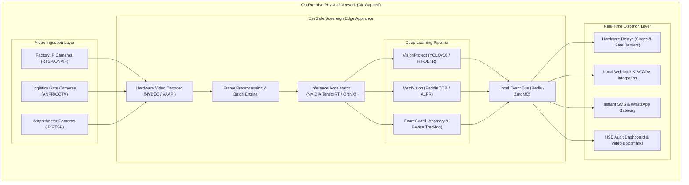
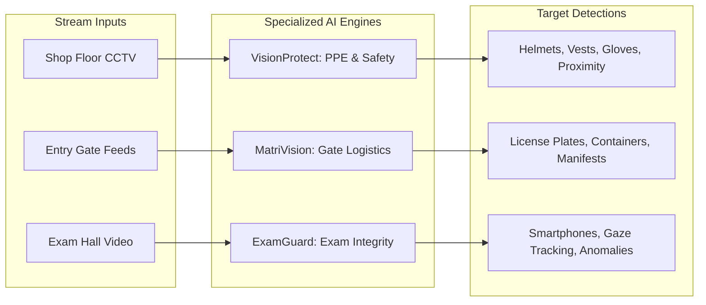
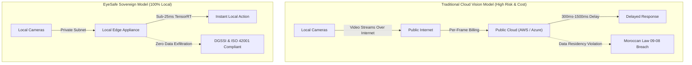

# EyeSafe: Sovereign Edge Computer Vision Platform

> Real-time computer vision intelligence for industrial PPE safety compliance, factory gate matriculation and freight tracking, and academic examination integrity. Powered by 100% on-premise sovereign edge AI at a fixed rate of 500 DH / camera / month.

[](https://eyesafe.ai)
[](https://eyesafe.ai)
[](https://www.iso.org/sectors/it-technologies/ai)
[](https://eyesafe.ai)

---

## Executive Summary

Modern industrial facilities, logistics hubs, and academic institutions rely on extensive CCTV and IP surveillance infrastructure. However, traditional cloud-based video analytics introduce critical challenges:

1. **Unpredictable Cloud Ingestion Costs:** Cloud vision APIs (AWS Rekognition, Google Cloud Vision, Azure AI) charge per-frame fees that scale into unsustainable monthly bills ($10,000 to $30,000+ per month for multi-camera 24/7 facilities).
2. **Data Sovereignty Violations:** Exporting internal operational video streams off-premise breaches national data residency laws (including Moroccan Law 09-08, DGSSI cybersecurity directives, and GDPR).
3. **High Latency and Internet Outages:** Roundtrip cloud latency (300ms to 1500ms) introduces unsafe delays and fails entirely during network disconnects.

EyeSafe replaces cloud dependencies with dedicated on-premise Sovereign Edge Nodes connected directly to the local camera network at 500 DH / camera / month, delivering sub-25ms inference with zero data leakage.

---

## System Architecture



---

## Core Industry Modules



### 1. VisionProtect: Industrial Safety & PPE Auditing
- **Real-Time PPE Detection:** Sub-second verification of hard hats, high-vis reflective vests, gloves, harnesses, and safety goggles.
- **Geofencing & Hazard Zones:** Instant alerts when personnel cross into overhead crane zones, automated cells, or heavy machinery tracks.
- **Forklift-Pedestrian Proximity:** Real-time distance estimation between mobile equipment and workers.

### 2. MatriVision: Logistics Gate & Truck Matriculation
- **Automated License Plate Recognition (ALPR/ANPR):** Sub-second plate recognition for Moroccan and international vehicle formats.
- **Container & Trailer Tracking:** OCR extraction of ISO 6346 container serials and trailer identification numbers.
- **Manifest Verification:** Cross-matches inbound trucks against delivery manifests to trigger barrier gates automatically and flag non-fleet vehicles.

### 3. ExamGuard: Academic & Examination Integrity
- **Concealed Device Detection:** Computer vision heuristics to identify smartphones, smartwatches, and unauthorized materials in examination rooms.
- **Suspicious Movement Tracking:** Detects anomalous communication and unauthorized interactions without biometric profiling.
- **Silent Proctor Dispatch:** Direct notifications with timestamped clip bookmarks sent to proctors' local devices.

---

## Data Sovereignty: Cloud vs. EyeSafe Edge



---

## ISO/IEC AI Management & Governance Standards

EyeSafe aligns with international standards for artificial intelligence governance, safety lifecycle, and risk management:

### Core ISO Standards for AI Integration

- **ISO/IEC 42001:2023 (Artificial Intelligence Management System - AIMS):** The primary international standard for establishing, implementing, maintaining, and continually improving an AI management system in industrial and enterprise operations.
- **ISO/IEC 23894:** Guidance on risk management tailored for artificial intelligence projects and operational computer vision systems.
- **ISO/IEC 5338:** Engineering lifecycle processes for neural network development, validation, deployment, and maintenance.
- **ISO/IEC 23053:** Standard terminology and architectural frameworks for machine learning components.

### Strategic Benefits
- **Risk Mitigation:** Controls risks related to data bias, model drift, false alarms, and environmental variations.
- **Regulatory Alignment:** Aligns internal operations with emerging global AI frameworks (EU AI Act) and national cybersecurity directives.
- **Traceability:** Immutable audit logging, structured incident playback, and verifiable inspection records.
- **Stakeholder Trust:** Verifiable proof of ethical, transparent, and privacy-preserving computer vision.

**Official Reference Links:**
- [ISO Official AI Standards Portal](https://www.iso.org/sectors/it-technologies/ai)
- [KPMG Insights on ISO/IEC 42001](https://kpmg.com/ch/en/insights/artificial-intelligence/iso-iec-42001.html)
- [Software Improvement Group AI Standards Guide](https://www.softwareimprovementgroup.com/blog/iso-standards-for-ai/)

---

## Transparent Pricing & 3-Year ROI Analysis

EyeSafe operates on a flat rate: **500 DH / camera / month**.

| Comparison Parameter | Traditional Cloud Vision APIs | EyeSafe Sovereign Edge |
|---|---|---|
| **Monthly Rate Structure** | ~$0.0015 / frame (unpredictable overages) | **Fixed 500 DH / camera / month** |
| **16 Cameras (3-Year Total)** | ~$84,000 USD (approx. 840,000 MAD) | **288,000 MAD (approx. $28,800 USD)** |
| **Net 3-Year Savings** | Baseline cloud expense | **552,000+ MAD Saved (~65% reduction)** |
| **Video Data Exfiltration** | Outbound across public internet | **0 MB (100% On-Premise LAN)** |
| **Inference Latency** | 300ms to 1500ms | **< 25ms Real-Time** |
| **Offline Resilience** | Fails during internet outage | **100% Operational Air-Gapped** |
| **Standards Alignment** | Third-party cloud dependency | **ISO/IEC 42001 & Law 09-08 Compliant** |

---

## Technical Specifications

| Parameter | Specification |
|---|---|
| **Inference Latency** | `< 25ms` per frame (batch size 1 to 4) |
| **Throughput** | 16 to 64 concurrent RTSP camera streams per 1U Edge Node |
| **Model Architectures** | YOLOv10-X, RT-DETR, ByteTrack, PaddleOCRv4 |
| **Inference Engines** | NVIDIA TensorRT 10.x, ONNX Runtime (CUDA / OpenVINO / Apple MPS) |
| **Camera Protocols** | RTSP, RTMP, ONVIF Profile S/G/T, H.264 / H.265 |
| **Alert Integrations** | Modbus TCP / GPIO Relays, Local Webhooks, MQTT, WhatsApp/SMS API Gateway, SMTP |
| **Network Footprint** | 100% LAN operation; requires zero internet connection |

---

## Static Web Application

The complete static frontend is stored in `docs/`, the publishing directory configured for GitHub Pages:

- **`docs/index.html`**: Semantic enterprise landing page presenting the platform, applications, private architecture, deployment approach, and contact path.
- **`docs/styles.css`**: Responsive editorial design system with cinematic media, accessible navigation, and restrained motion.
- **`docs/app.js`**: Lightweight interactions for bilingual English/French content, navigation, video playback, and reveal transitions.
- **`docs/assets/`**: Product demonstration videos and application imagery.

### Local Development / Preview

```bash
# Option 1: Using Python 3 HTTP server
python3 -m http.server 8080 --directory docs

# Option 2: Using Node.js serve
npx -y serve docs

# Open in browser: http://localhost:8080
```

---

## Deployment to GitHub Pages

1. Commit and push changes:
   ```bash
   git add .
   git commit -m "feat: update website"
   git push origin main
   ```
2. In your repository on GitHub, navigate to **Settings** -> **Pages**.
3. Under **Branch**, select `main` and the `/docs` folder, then click **Save**.

---

## Enterprise Inquiries

- **Phone / WhatsApp:** +212 666-774426
- **Email:** contact@eyesafe.ai
- **Location:** Casablanca / Benguerir, Morocco

---

## License & Intellectual Property

Copyright (c) 2026 EyeSafe Computer Vision. All rights reserved. Designed and developed for sovereign enterprise, industrial, and institutional environments.
